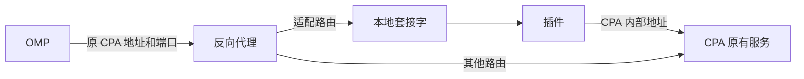

# CPA OMP Adapter

CLIProxyAPI（CPA）的原生插件：让 oh-my-pi（OMP）以 `openai-codex` 协议发现 CPA 模型，并可在 CPA 管理页面中设置模型别名、显示名和能力。

## 工作方式

插件使用 **本地 Unix 域套接字**与现有反向代理通信，不新增对外 TCP 端口。反向代理把原 CPA 地址下的 `/omp/backend-api/...` 转给插件；插件再使用 CPA 客户端 API Key 调用同一 CPA 实例。普通 CPA 路由保持原样。



需要已有反向代理，或先在 CPA 前部署反向代理。如果 CPA 当前直接占用对外端口，必须把 CPA 迁到内部地址，让反向代理接管原端口；**外部地址不变，但 CPA 内部监听地址需要调整**。插件不能通过 CPA 的标准插件接口直接添加普通客户端路由，因此不能仅安装动态库就跳过这一步。

插件仅影响适配前缀下的请求，不修改其他客户端看到的 CPA 原始模型列表。配置更新会关闭已建立的适配器 WebSocket，客户端需重连。

管理中心地址 `management.html#/plugin-pages/cpa-omp-adapter/0` 中的 `#...` 是浏览器前端路由，不会发给 CPA；管理中心实际通过 iframe 加载 `/v0/resource/plugins/cpa-omp-adapter/index.html`。CPA 插件资源路由只提供 GET 页面/资源，不能直接承载普通客户端鉴权的 Responses POST、SSE 和 WebSocket；管理路由又需要管理密钥，不应把该密钥交给模型客户端。

社区的 [pi-bridge](https://github.com/abix5/pi-cliproxyapi-bridge) 使用资源 GET 路由和客户端扩展获取目录及用量，[model-mapper](https://github.com/DoingDog/cpa-plugin-model-mapper) 则通过 CPA 已有推理路由做模型映射；它们都不会让 OMP 原生 Codex 的模型发现路径自动出现。可研究「OMP 扩展负责发现 + CPA 插件负责映射」来免反代，但需要在每个客户端安装扩展，并单独验证 OMP 的目录合并和鉴权行为；当前实现仍使用上述反向代理方案。

## 安装

使用支持动态插件的 CPA；本项目实际验证过 CPA **v8.0.76**。管理 API 响应头 `X-CPA-SUPPORT-PLUGIN: 1` 只表示构建支持插件，还需要启用全局插件开关。

### 通过插件商店安装和更新

商店源地址：

```text
https://raw.githubusercontent.com/azmiao/cpa_omp_adapter/main/registry.json
```

在 CPA 管理中心的插件商店添加该源；如果界面没有添加入口，可将它合并到 CPA 配置的 `plugins` 节点：

```yaml
plugins:
  enabled: true
  dir: "plugins"
  store-sources:
    - "https://raw.githubusercontent.com/azmiao/cpa_omp_adapter/main/registry.json"
```

1. 保存配置并刷新插件商店，搜索 `cpa-omp-adapter`，选择本商店源后点击安装。商店源清单必须已推送到 `main`，并且仓库已有正式 Release，才能下载安装。
2. 已安装时，商店会根据 GitHub 最新正式 Release 检查更新；有新版本时点击更新。安装或更新会校验发布包的 SHA-256；如界面提示需要重启，请重启 CPA 后再检查插件状态。
3. 添加商店源和安装插件都不会自动打开全局 `plugins.enabled`。CPA 所在服务器或容器需要能够访问商店源及 GitHub Release。

若安装或检查更新时遇到 GitHub API `429` 限流，请按响应的 `Retry-After` 等待；如经常遇到限流，可参考 [CPA 插件商店认证配置](https://help.router-for.me/configuration/options.html)用环境变量提供权限受限的 GitHub Token，不要把 Token 写入配置文件或提交到仓库。

也可使用 CPA v8 管理 API 的 `GET /v8/management/plugins/store` 查看商店来源和更新状态，通过 `POST /v8/management/plugins/store/cpa-omp-adapter/install` 安装或更新。API 必须使用管理密钥；同 ID 存在多个来源时按商店返回的 `source_id` 指定 `?source=...`。

### 手动安装

从 [GitHub Releases](https://github.com/azmiao/cpa_omp_adapter/releases) 下载对应平台 ZIP；ZIP 根目录即为动态库，并提供 `checksums.txt` 校验。将动态库命名为 `cpa-omp-adapter` 并复制到 CPA 的插件目录：Linux 使用 `.so`、macOS 使用 `.dylib`、Windows 使用 `.dll`。也可按本文末尾说明从源码构建；本地 `dist/` 不加入 Git。

手动安装后，确保全局插件开关与该插件均已启用，然后重启 CPA。已有配置请合并，不要覆盖其他插件：

```yaml
plugins:
  enabled: true
  dir: "plugins"
  configs:
    cpa-omp-adapter:
      enabled: true
```

### 配置适配器

确保 CPA 已设置管理密钥和至少一个**客户端 API Key**。通过 CPA 管理中心的「OMP 适配器」菜单打开插件，或访问：

```text
https://<原CPA地址>/v0/resource/plugins/cpa-omp-adapter/index.html
```

输入 CPA **管理密钥**连接页面。填写插件访问 CPA 的**内部地址**、套接字路径和路由前缀并保存，再按页面中的示例配置反向代理。管理密钥仅保存在当前页面内存，刷新后需重新输入。在 OMP 使用页面显示的 Base URL 和 CPA **客户端 API Key**；不要把管理密钥或官方 OpenAI OAuth token 用作客户端密钥。

在「从 CPA 获取可选模型」中填写**客户端 API Key**并获取目录后，可按名称或完整 ID 搜索、分批查看全部模型，并直接点击「添加映射」。新映射默认保留原始模型 ID；如需别名，在映射卡片中修改 OMP 可见模型 ID 并保存。存在映射冲突时，页面仍会显示 CPA 原始目录和警告，方便修正配置。

页面复制会优先使用浏览器剪贴板 API；普通 HTTP 或 API 不可用时尝试浏览器的选择式复制。如果浏览器或 iframe 策略禁止两种方式，页面会选中内容并提示手动复制。公网部署仍建议使用 HTTPS。

页面里的「插件已就绪」只表示本地套接字已经监听，**不代表反向代理已配置或对外地址可访问**。更改套接字路径或路由前缀后，要同步更新并重载反向代理。WebUI 只生成配置示例，不会替你修改反向代理。保存通过 CPA v8 管理 API 写入并热重载配置；若原配置是旧格式，CPA 的首次 v8 写入可能将其迁移为 v8 格式。

### 套接字与权限

- 默认路径为系统临时目录下的 `cpa-omp-adapter.sock`；可在 WebUI 更换，父目录必须已经存在。不同 CPA 实例应使用不同路径。
- Linux/macOS 默认权限 `0660`。确保运行 CPA 和反向代理的账号能够访问该目录及套接字；通常应使用受保护的目录和共同用户组。WebUI 可选 `0600`、`0660` 或 `0666`；`0666` 允许所有本机用户连接，应谨慎使用。
- Windows 使用系统文件访问控制，界面中的 Unix 权限不生效。Windows 路径可使用 `C:/.../adapter.sock`，代理也必须支持 Windows Unix 域套接字。
- 容器部署时，CPA 与代理须共享同一套接字目录，并保证 UID/GID 和目录权限匹配。仅映射 CPA 的 TCP 端口不能让另一个容器访问该套接字。
- 插件不会覆盖普通文件或正在使用的套接字；对拒绝连接、确认已失效的套接字会尝试恢复。仍无法启动时，先检查该路径、目录权限和 CPA 日志，不要盲目删除文件。

## 反向代理

以下示例假定 WebUI 中的路由前缀为 `/omp`，套接字为 `/run/cpa-omp/adapter.sock`，CPA 内部地址为 `http://127.0.0.1:8317`。这些值须按实际部署修改，套接字目录也须事先创建。公网应使用 HTTPS；管理接口还应通过 VPN、访问控制等限制访问，不能只依赖反向代理连接到 CPA 的本机地址。

### Caddy

在**已有 CPA 站点块**中增加匹配规则，保留原有的 CPA 转发。不要另外创建新的对外端口：

```caddyfile
@omp path /omp/backend-api/*
reverse_proxy @omp unix//run/cpa-omp/adapter.sock

# 已有 CPA 转发示例；站点中已有该规则时不要重复添加
reverse_proxy 127.0.0.1:8317
```

Windows 路径示例：`reverse_proxy @omp "unix/C:/path/to/adapter.sock"`。WebUI 可根据当前路径生成 Caddy 或 Nginx 片段。Caddy 自动处理 WebSocket 升级；请保留 SSE 流式传输。

### Nginx

将 `map` 放在 `http` 块，将 `location` 放在现有 CPA 的 `server` 块；保留已有的 CPA 反向代理规则：

```nginx
map $http_upgrade $omp_connection_upgrade {
    default upgrade;
    ''      close;
}

location ^~ /omp/backend-api/ {
    client_max_body_size 32m;
    proxy_pass http://unix:/run/cpa-omp/adapter.sock:/omp/backend-api/;
    proxy_http_version 1.1;
    proxy_set_header Host $host;
    proxy_set_header Upgrade $http_upgrade;
    proxy_set_header Connection $omp_connection_upgrade;
    proxy_buffering off;
    proxy_cache off;
    proxy_request_buffering off;
    proxy_read_timeout 3600s;
    proxy_send_timeout 3600s;
}
```

修改后先运行 `nginx -t`，通过后再按现有运维流程重载。`client_max_body_size` 应与 WebUI 的请求体上限一致；代理和 CPA 的其他限制也不能小于该值。必须保留查询参数和客户端认证头；不要开启模型目录缓存，也不要缓冲 SSE。UI 中生成的 Nginx 示例面向 Unix 路径；Windows 可选择 Caddy。

## OMP 配置

在 `~/.omp/agent/models.yml` 合并以下 provider 配置；`CPA_API_KEY` 是客户端 API Key 对应的环境变量，设置环境变量后再启动 OMP：

```yaml
providers:
  openai-codex:
    baseUrl: "https://<原CPA地址>/omp/backend-api"
    api: openai-codex-responses
    apiKey: CPA_API_KEY
```

使用 `omp models openai-codex --json` 检查发现结果；如有旧缓存可使用 `omp models refresh`。例如带前缀模型 `account-a/gpt-5.5` 的选择器为 `openai-codex/account-a/gpt-5.5`，自定义别名 `work-codex` 的选择器为 `openai-codex/work-codex`。

## 模型与账号安全

- 不添加映射时，直接返回 CPA 的当前 Codex 格式目录；目录是注册信息，不保证账号实时可用或有剩余额度。
- 新增映射时，目标应为 CPA 中完整的模型 ID，包括账号前缀。自定义 ID 与目标 ID 相同时只覆盖元数据，不重写模型请求。
- 不同 ID 的别名会在普通推理、SSE、WebSocket 和压缩请求中映射回目标，并在支持的响应模型字段中还原别名。每次别名请求都会以客户端密钥检查 CPA 当前目录；目标不存在或不唯一时拒绝请求，不回退到其他模型。
- 别名与 CPA 现有模型 ID 冲突时，目录和该别名请求返回 `409`，需要修改别名。缺失的目标不会被加入目录，直接请求该别名返回 `404`。
- 别名和显示名**不保证账号隔离**。不同账号应使用唯一前缀，并检查 CPA 的 `routing.force-model-prefix`、凭据选择和故障转移配置；需要严格隔离时，必须在实际部署中验证失效、冷却与故障转移不会切换账号。
- 模型能力默认继承目标目录；仅覆盖已确认的上下文窗口、输入类型和推理等级。OMP 只读取部分目录字段，例如 v18.22.0 不直接使用目录里的 `max_tokens`，不能据此保证输出上限或工具能力。
- 插件不会保存管理密钥、客户端 API Key 或 OAuth 凭据，不读取 OAuth 凭据文件；但原生插件与 CPA 进程具有同等权限，应只安装可信构建。

## 从源码构建和验证

需要 Go 1.24+、对应平台的 C 编译器和 CGO。以下命令在目标平台本机构建；生成的 `.h` 是 Go 的构建副产物，部署只需要动态库。

```sh
mkdir -p dist
go test ./internal/adapter
CGO_ENABLED=1 go build -buildvcs=false -buildmode=c-shared \
  -o dist/cpa-omp-adapter.so ./cmd/cpa-omp-adapter
```

Windows PowerShell（已安装可供 Go 使用的 GCC）：

```powershell
New-Item -ItemType Directory -Force dist | Out-Null
$env:CGO_ENABLED = '1'
go build -buildvcs=false -buildmode=c-shared -o dist/cpa-omp-adapter.dll ./cmd/cpa-omp-adapter
```

动态库需与 CPA 的操作系统和架构一致。当前 Windows amd64 构建已在 CPA v8.0.76、Caddy 和 OMP v18.22.0 的隔离环境验证；两个上游账号使用本地模拟服务，并非真实 OAuth 账号。Linux amd64 构建已交叉编译，尚未在 Linux CPA 运行时验证。

## 自动构建与发布

推送 `main`、`feature/**` 分支、向 `main` 发起 Pull Request，或手动运行工作流时，GitHub Actions 会分别在五个平台构建并验证原生 ABI：Linux amd64/arm64、macOS amd64/arm64 和 Windows amd64。非标签构建的临时产物使用 `0.0.0` 版本，可从工作流的 Artifacts 下载，不会创建 Release。

推送 `vX.Y.Z` 格式的标签会触发同样的构建，并在全部平台验证通过后创建 GitHub Release，上传五个 CPA 插件 ZIP 和 `checksums.txt`。标签版本同时写入动态库的插件元数据；例如：

```sh
VERSION=0.1.2  # 替换为尚未发布的版本号
git tag "v${VERSION}"
git push origin "v${VERSION}"
```

发布使用 GitHub 提供的 `GITHUB_TOKEN`；仓库需启用 Actions，并允许工作流对仓库内容进行写入。此工作流不会自动创建或推送标签。