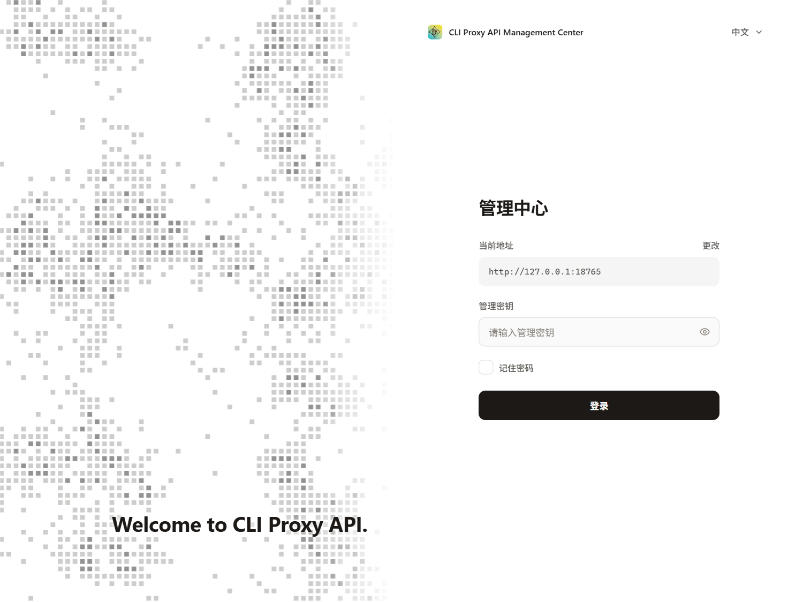
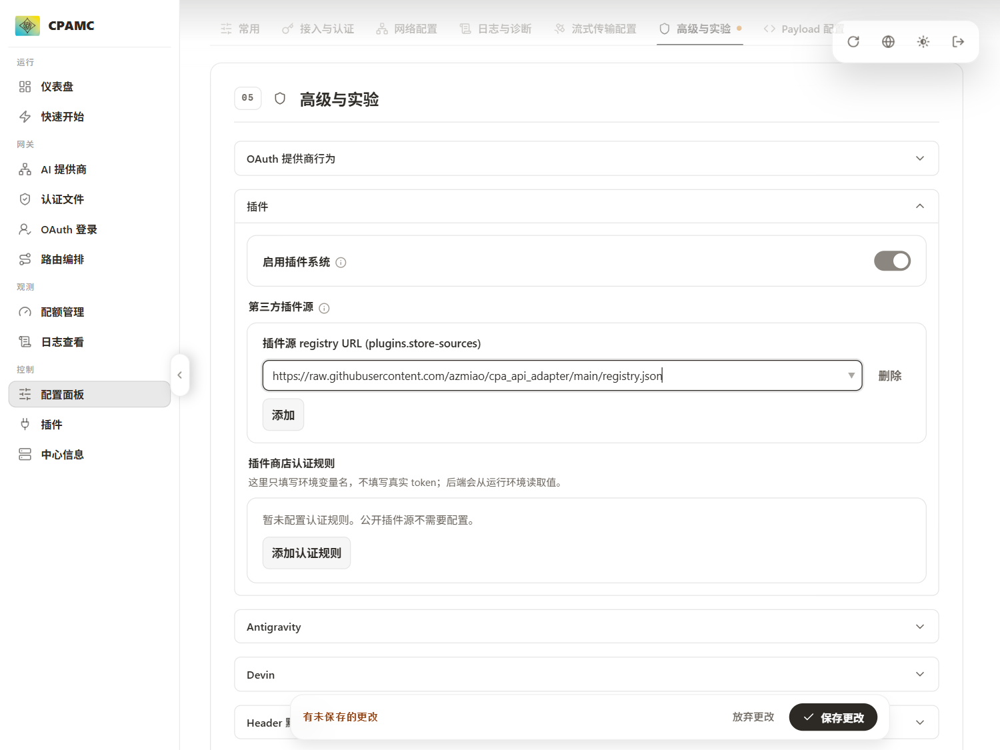
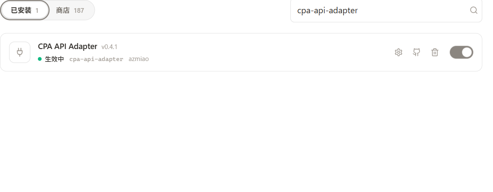
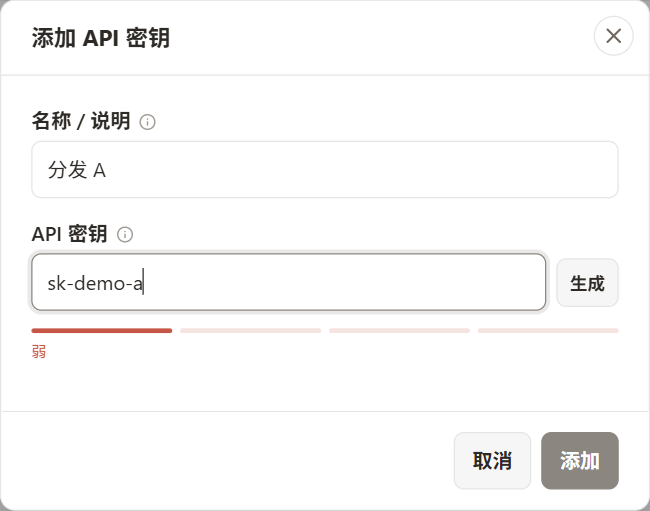
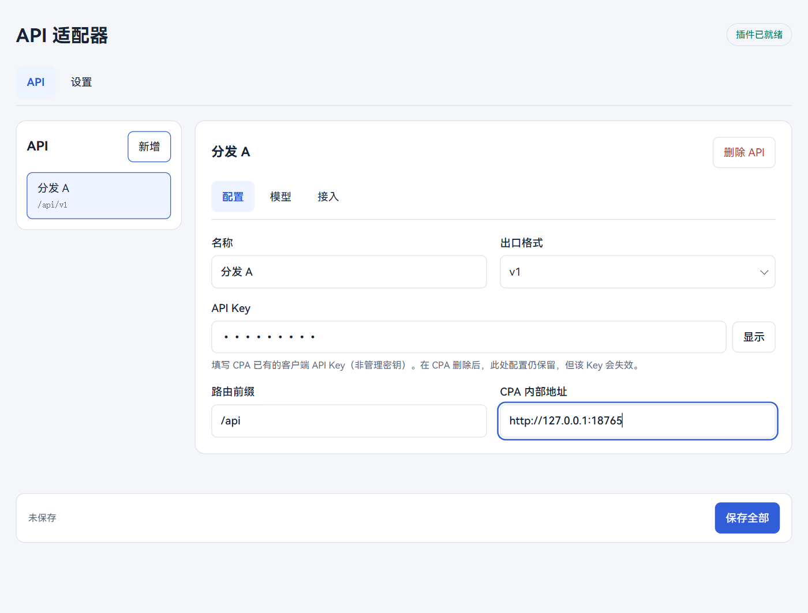
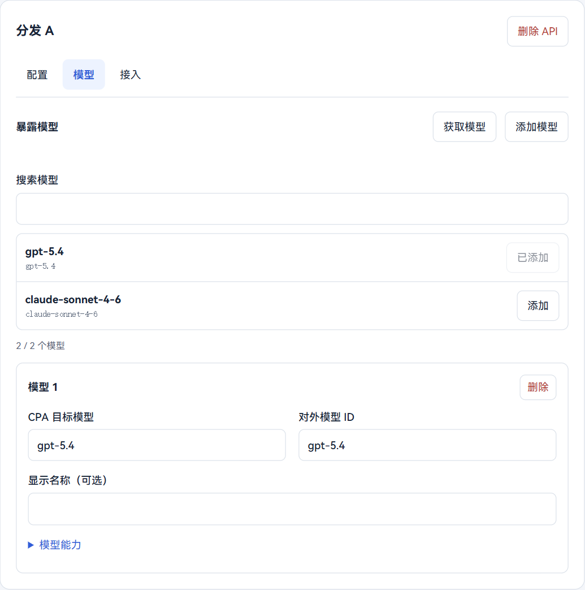
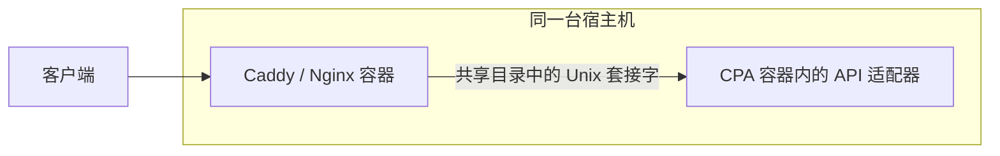

# CPA API Adapter

给 CLIProxyAPI（CPA）增加独立的 API 入口：**给不同 Key 分发不同模型**，或**用 backend-api 补全接口并接入 oh-my-pi**。

已有能正常使用的 CPA？按下面的页面步骤操作即可，**不用手写 CPA 的 YAML 配置**。

> 截图使用演示密钥和模型。不要照抄截图中的 Key；地址与端口要换成你自己的。

- [从页面安装插件](#1-从页面安装插件)
- [新增 API、选择模型](#2-新增-api选择模型)
- [按部署方式连接](#3-按部署方式连接)
- [把地址交给客户端](#4-把地址交给客户端)
- [接入 oh-my-pi](#5-接入-oh-my-pi可选)
- [遇到问题](#遇到问题)

## 1. 从页面安装插件

### 登录 CPA 管理中心

打开 `http://你的CPA地址:端口/management.html`，例如 `http://127.0.0.1:8317/management.html`。输入 **CPA 管理密钥**，点击「登录」。



### 打开插件开关、添加商店源

1. 左侧「配置面板」→「可视化」→「高级与实验」，展开「插件」。
2. 打开「启用插件系统」。
3. 在「第三方插件源」点击「添加」，粘贴下面的地址：

   ```text
   https://raw.githubusercontent.com/azmiao/cpa_api_adapter/main/registry.json
   ```

4. 点击「保存更改」，在弹出的确认窗口点击「确认保存」。



### 在商店点击安装

1. 左侧「插件」→「商店」，搜索 `cpa-api-adapter`。
2. 找到 **CPA API Adapter**，点击右侧「安装」，选择「最新稳定版」。

[](docs/images/03-store-install.png)

3. 确认仓库是 `azmiao/cpa_api_adapter`，阅读风险提示。只有信任此插件时才继续；按提示输入 `azmiao/cpa_api_adapter`，点击「安装此插件」。


4. 安装完成后，在「已安装」确认插件开关已打开。若页面提示需要重启 CPA，先重启，再刷新管理页面。



左侧会出现 **「API 适配器」**。打开它，再输入同一个 CPA 管理密钥，点击「连接」。后面的 API、模型、监听设置都在这个页面操作。

> 看不到「插件」或可视化开关？先升级到支持动态库插件的 CPA 与新版[官方管理页面](https://github.com/router-for-me/Cli-Proxy-API-Management-Center)。

## 2. 新增 API、选择模型

### 先准备私有 CPA 上游 Key

在 CPA 新建一个**从未分发给用户的私有客户端 Key**，仅供插件访问 CPA。已有独立私有 Key 也可以使用：

1. 回到 CPA「配置面板」→「可视化」→「常用」。
2. 在「客户端 API 密钥」点击「添加 API 密钥」，填写新的私有 Key，点击「添加」。名称只是便于识别，可不填。
3. 点击「保存更改」→「确认保存」，复制刚添加的 Key。



**管理密钥仅用于登录；CPA 上游 Key 仅供插件调用 CPA；插件 API Key 才交给用户。插件 API Key 不得登记在 CPA，也不能与任何 API 的上游 Key 相同。**

### 新增第一条 API

进入「API 适配器」，在「API配置」页点击「新增」，填写：

| 页面字段 | 怎么填 |
| --- | --- |
| 名称 | 例如「分发 A」，便于自己识别。 |
| 出口格式 | 普通 OpenAI 兼容客户端选 `v1`。 |
| 插件 API Key | 使用密码管理器生成独立随机 Key，只保存到插件，不要添加到 CPA；此 Key 交给用户。 |
| CPA 上游 API Key | 粘贴上一步准备的私有 CPA 客户端 Key，必填，不能交给用户。 |
| 路由前缀 | 例如 `/api`，必须带 `/`，不能只填 `/`。 |
| CPA 内部地址 | 通常是 `http://127.0.0.1:8317`，端口换成 CPA 实际监听端口。 |



这里填写的是 **CPA 原有地址**，不是稍后设置的插件端口。截图的演示 CPA 使用 `18765`；你的 CPA 使用什么端口就填什么端口。

### 选择要分发的模型

1. 切到「模型」，点击「获取模型」。
2. 在想开放的模型右侧点击「添加」。
3. 初次使用不用改「CPA 目标模型」和「对外模型 ID」；需要别名时，再修改「对外模型 ID」。



**不添加任何模型表示开放全部模型；添加后只开放所选模型。** 接着按下一节设置连接方式，最后点击「保存全部」。

### 给另一个人分发不同模型

再新增「分发 B」，使用另一个**插件 API Key**，选择另一组模型即可。CPA 上游 Key 可以复用同一个私有 Key；需要在 CPA 区分各 API 的用量时，分别配置不同的私有上游 Key：

| API | 路由前缀 / 出口格式 | 插件 API Key（给用户） | CPA 上游 Key（不分发） | 开放模型示例 |
| --- | --- | --- | --- | --- |
| 分发 A | /api / v1 | Key A | Private Key | gpt-5.4 |
| 分发 B | /api / v1 | Key B | Private Key | claude-sonnet-4-6 |

两个人可以使用同一个 Base URL，但各自带不同的插件 Key，看到不同的模型列表。**路由前缀、出口格式、插件 Key 三项全部相同的 API 不能重复保存。**

### 升级到 v0.5.0（双 Key）

v0.5.0 不兼容旧版的 Key 复用：缺少 `apis[].upstream_api_key` 时不启动插件监听，也不会自动使用 `api_key` 作为上游 Key；管理页面仍可打开并补填配置。

1. 在 CPA 新建未分发过的私有 Key。
2. 从 CPA 客户端 Key 列表移除所有已分发给插件用户的旧 Key，防止迁移期间继续绕过插件。此时旧版入口可能暂时不可用。
3. 升级后打开「API 适配器」，保留每条 API 原来的「插件 API Key」，补填「CPA 上游 API Key」，点击「保存全部」。用户的插件 Key 不需要更换。
4. 验证同一个用户 Key：通过插件只能调用所选模型；直接访问原始 CPA `/v1/models` 返回 `401`。若原始 CPA 仍接受用户 Key，迁移尚未完成。

CPA 原始接口可以继续给持有独立 CPA Key 的其他客户端使用，但受限制的插件用户不能持有任何有效 CPA Key。原始端口和管理入口的网络隔离仍建议保留。

## 3. 按部署方式连接

只选与你实际部署相符的一种。**CPA 内部地址仍指向 CPA 原有端口**；下面设置的是插件如何接受客户端或反代的连接。

### A. CPA 直接运行在宿主机

先用 TCP 跑通，最省事：

1. 「API 适配器」→「通用设置」，监听方式选 **TCP**。
2. 客户端也在本机：填写 `127.0.0.1:18318`。客户端在另一台内网主机：填写 **CPA 宿主机的内网 IP:18318**，例如 `10.0.0.10:18318`。
3. 点击「保存全部」。确认顶部显示「插件已就绪」，「实际监听地址」是刚保存的 TCP 地址。


本机客户端可以直接连接，不需要额外反代。若已有同机 Caddy / Nginx，也可选择 Unix 套接字并复制反代配置：先创建可用的本机目录，Linux 示例路径 `/run/cpa-api/adapter.sock`，Windows 填本机绝对路径。

**不要把明文 HTTP 插件端口直接暴露到公网。** 公网访问应使用 HTTPS 反代；跨主机连接限制来源，必要时使用 VPN。

### B. CPA 在 Docker，Caddy 等反代也在本机

推荐 **Unix 套接字**，不需要额外发布插件 TCP 端口。



1. **先配置 Docker 挂载。** 给 CPA 和反代容器挂载同一个宿主机目录，两边的容器路径都使用 `/run/cpa-api`。Docker 管理工具可通过挂载设置完成；这一步不能在 CPA 页面完成。

<details>
<summary>使用 Docker Compose？展开查看最少需要增加的内容</summary>

在 Compose 所在目录创建 `./cpa-api-socket`，将下面的挂载合并到现有服务，保留原有配置，注意两个服务挂载的宿主机 cpa-api-socket 目录要同一个，让两个服务都能读取到才行：

```yaml
services:
  cli-proxy-api:
    volumes:
      - ./cpa-api-socket:/run/cpa-api
  caddy:
    volumes:
      - ./cpa-api-socket:/run/cpa-api:ro
```

将服务名换成你实际使用的名称，应用 Compose 改动。目录需让 CPA 可写、反代可访问；权限 `0660` 的套接字要求两侧进程具有共同用户组。

</details>

2. 回到插件「通用设置」，选择 **Unix 套接字**；路径填写 `/run/cpa-api/adapter.sock`，权限保持 `0660`，点击「保存全部」。


3. 在当前 API 的「接入」页选择 Caddy 或 Nginx，点击「复制配置」。放入已有反代站点，保留原有 CPA 转发规则，检查配置后重载反代。

   Nginx 片段中的 `upstream` 放在 `http {}` 内，同一套接字只添加一次；各 API 的 `location` 放在站点的 `server {}` 内。共享连接池使用 `keepalive 32`，普通 HTTP 请求不再强制关闭连接。WebSocket 默认禁用，片段不包含升级配置；启用时还需添加同样放在 `http {}` 内的共享 `map`，并更新各 API 的 `location`。


相同 Base URL 的多个 Key **只需一份反代规则**；其他路径的 API 再增加对应规则。保存后在「通用设置」确认实际监听状态，目录挂载与权限正确后反代才能连接。

### C. CPA 在 Docker，反代在另一台服务器

> 此方案一般用不到，除非你的CPA所在服务器在境内且未备案，必须用已备案的服务器部署反代连接CPA所在服务器，此时才使用本方案

不同主机一般来说不能共用 Unix 套接字，建议使用 **TCP**：

1. 插件「通用设置」选 **TCP**，监听地址填 `0.0.0.0:18318`，点击「保存全部」。这里的 `0.0.0.0` 表示监听容器接口，不是给远端反代填写的连接地址。
2. 在 Docker 管理工具中，把容器 `18318` 端口发布到 CPA 宿主机的内网接口。不要删除 CPA 原有端口。

<details>
<summary>使用 Docker Compose？展开查看端口发布示例</summary>

向现有 CPA 服务追加：

```yaml
services:
  cli-proxy-api:
    ports:
      - "18318:18318"
```

换成实际服务名和宿主机所需端口，应用 Compose 改动。插件的「CPA 内部地址」通常仍是 `http://127.0.0.1:8317`，一般来说不需要修改。

</details>

3. **到远端反代服务器配置连接目标**：CPA 宿主机增加放行端口 18318

<details>
<summary>反代服务器 Nginx 示例</summary>

```text
# map/upstream 放在 http {} 内，只添加一次。
map $http_upgrade $cpa_adapter_connection {
    default upgrade;
    '' '';
}

upstream cpa_adapter_remote {
    server x.x.x.x:18318;                  # 替换为 CPA 宿主机 IP 与插件发布端口
    keepalive 32;
}

server
{
  listen 80 ;
  listen 443 ssl ;
  server_name cpa.xxxxx.com;               # 替换为自己的域名

  location ^~ /adapter/ {                  # 替换为自己想要的代理前缀
      proxy_pass http://cpa_adapter_remote/;
      proxy_http_version 1.1;
      proxy_set_header Upgrade $http_upgrade;
      proxy_set_header Connection $cpa_adapter_connection;
      client_max_body_size 32m;           # 按插件的请求/消息上限调整
      proxy_buffering off;
      proxy_cache off;
      proxy_request_buffering off;
      proxy_read_timeout 3600s;
      proxy_send_timeout 3600s;
  }
  
  location / {
      proxy_pass http://x.x.x.x:8317/;     # x.x.x.x 替换为CPA所在服务器，8317替换为CPA对外暴露的端口
  }
}
```

如此配置可让 `https://cpa.xxxxx.com` 访问CPA本体，让 `ttps://cpa.xxxxx.com/adapter` 访问插件转发的 api。

</details>

4. 防火墙只允许反代服务器访问CPA服务器所用到的插件端口 18318 。客户端使用反代的 HTTPS 域名，不使用容器监听地址。TCP 模式不提供一键反代配置，远端反代由你自行配置。

5. 若按照上面示例配置后，假设插件增加了一个 v1 格式的 API，可用 `http://cpa.xxxxx.com/adapter/{路由前缀}/v1` 替代原有的 `http://cpa.xxxxx.com:18318/{路由前缀}/v1`

## 4. 把地址交给客户端

1. 回到当前 API 的「接入」页，点击「复制地址」。
2. 在客户端填写 **Base URL + 这个 API 对应的插件 API Key**，不要填写 CPA 上游 Key。
3. 获取客户端模型列表，确认只显示选中的模型，再发起请求。


本机 TCP 示例：`http://127.0.0.1:18318/api/v1`。使用反代时，改为实际入口，例如 `https://api.example.com/api/v1`。

Unix 预览地址按管理页面的 Origin 生成，配置好反代后才能使用；TCP 通配绑定使用管理页面主机名预览。**公网域名、HTTPS 或 Docker 发布端口不同时，客户端填写实际可达的入口。**

## 5. 接入 oh-my-pi（可选）

只做模型分发，可以跳过本节。需要覆盖 oh-my-pi 的 Codex 提供商时：

1. 在插件新增 API，名称可填 `oh-my-pi`，路由前缀填 `/codex`，出口格式选择 **`backend-api`**。
2. 分别填写插件 API Key、私有 CPA 上游 API Key 和内部地址，在「模型」中获取并添加需要的模型，点击「保存全部」。高级模型能力初次使用可不修改，先沿用 CPA。


3. 到「接入」复制地址；使用 Unix / 反代时，补齐该路径的反代规则。
4. 在 **客户端**的 `~/.omp/agent/models.yml` 合并以下内容。这里是 oh-my-pi 的文件，不是 CPA 配置：

```yaml
providers:
  openai-codex:
    baseUrl: "https://api.example.com/codex/backend-api"
    api: openai-codex-responses
    apiKey: CPA_ADAPTER_API_KEY
```

把 `baseUrl` 换成实际接入地址，并将 `CPA_ADAPTER_API_KEY` 环境变量设为对应的**插件 API Key**，不是 CPA 上游 Key。运行 `omp models openai-codex --json` 查看模型；需要刷新时运行 `omp models refresh`。

插件提供 Codex 风格目录、模型别名与能力配置，以及 Responses 的 HTTP / SSE / WebSocket 和 compact 转发。上游仍须支持相应模型与接口；**不会把 Chat Completions 转换为 Responses**。

**WebSocket 默认禁用。** 在「通用设置」将「WebSocket」设为「启用」，点击「保存全部」后生效；配置字段为 `websocket_enabled`，旧配置未填写时也按 `false` 处理。关闭时两个 WebSocket 入口返回 `403`，不会连接上游，已有 WebSocket 连接会断开；HTTP、SSE 和 compact 转发不受影响。使用 Nginx 反代时，启用后需重新复制「接入」页生成的升级配置并重载 Nginx；直连 TCP 不需要 Nginx。

管理页面随窗口宽度伸展，主容器最大 1920px；桌面两侧保留 32px 内边距，窄屏沿用单列布局。调用日志表格在空间不足时仅于表格内部横向滚动。

## 调用日志

插件页面的顶层页签为「API配置｜调用日志｜通用设置」。连接管理中心后，打开「调用日志」查看记录，按 API、模型、结果筛选，每页最多 50 条。只有日志页可见时才每 5 秒刷新；「刷新」返回最新一页。筛选和翻页不会修改或保存 API 配置。

- **只保留最近 1,000 条元数据，不落盘，重启清空。** 保存配置不会清空已有记录；API 名称和路由保留调用时的快照。
- 显示 API 名称和路由、模型及配置的 CPA 目标、接口类型、HTTP / SSE / WebSocket、IP、状态码和最终结果、总耗时、响应字节数，以及有返回时的输入 / 输出 / 总 tokens 和缓存率。另展示当前保留记录的成功率、失败 / 中断次数、限流次数和平均耗时；进行中数量包含仍未结束、但已被容量上限覆盖的调用。
- 不保存请求或响应正文、密钥、完整请求头、URL 查询参数或上游错误消息；错误仅展示简短代码和 `Retry-After`。日志接口沿用 CPA 管理鉴权，不向普通插件 Key 开放。
- IP 优先记录 `X-Forwarded-For` 第一项中的有效 IP，其次 `X-Real-IP`，否则记录连接来源；页面标明来源。**转发头未经可信代理校验，可被伪造，不作为鉴权依据。** 代理未传递真实 IP 或使用 Unix 套接字时，记录可能只是代理地址或没有 IP。
- 普通 HTTP 每次请求一条；WebSocket 每轮新响应一条，活动响应的 `append` 不增加调用次数。失败的握手、被拒绝的新建响应也记录。流中的失败、未完整生成、缺少结束事件和连接中断不以 HTTP `200` 或 WebSocket `101` 直接认定为成功。
- Tokens 仅从可解析的上游 `usage` 获取，不估算、不改写请求来强制获取。缓存率为缓存输入 tokens ÷ 输入 tokens；字段缺失或分母为零显示 `—`，明确返回零缓存时显示 `0%`。
- 日志观察使用有界流式扫描，不缓存整段提示词、回答或 SSE 会话；不改变转发字节或 flush 行为。无法解析的元数据、非推理接口没有模型等情况显示 `—`。客户端明确要求保留压缩编码且响应未被现有改写流程解压时，不额外解压统计；usage 留空，无法观察终态的压缩 SSE 显示「未确认」。

## 转发边界与性能

- WebSocket 只允许 `/v1/responses` 和 `/backend-api/codex/responses` 这两个专用入口；其他路径的协议升级会被拒绝，不作为透明隧道转发。
- 每条 WebSocket 连接最多一个未完成的 `response.create`，并发第二次创建返回 `409`。上游确认接受前，`append` 等后续事件也返回 `409`，避免其错误被误认为创建失败；确认后的活动响应 `append` 不增加轮次，也不能更换模型。后续请求可继承最后由上游确认接受的模型。
- 配置了模型白名单时，已有 Responses 资源按实际上游 `model` 核验后才能读取。`input_items`、取消、删除及 HEAD 操作会先检查主资源；无法确认模型时拒绝访问。同一目标有多个别名时，资源展示使用配置中的第一个别名。未配置白名单仍开放全部模型。
- 已配置模型的身份与 CPA 的临时可用性分离：目标暂未出现在 CPA 目录中时，客户端目录仍保留配置的模型 ID，并通过 `X-Adapter-Warning` 提示。此时仅使用配置中明确填写的能力，不复用过期目录或虚构上游能力；需要冷却期间能力也保持稳定时，请在「模型能力」显式填写。
- 白名单仍先决定能否调用；目录中目标暂时缺席不再由插件判定为 `404`，别名仍改写到配置的 CPA 目标，由 CPA 推理接口返回真实的 `429`、`404` 等状态。真正重复的目标及别名与 CPA 模型冲突仍拒绝路由。
- HTTP 推理限流保留 CPA 的 `429` 和 `Retry-After`，WebSocket 保留上游限流事件及重试信息，不把目录暂时缺席转换成不可重试的「模型不存在」。此行为不需要修改 oh-my-pi；未知或确实已删除的目标仍可能由 CPA 返回真实 `404`。
- 模型目录按上游、私有上游 Key、账号、客户端相关请求头及查询参数隔离，缓存 **15 秒**并合并同键并发请求；不缓存失败或返回过期数据。缓存最多 256 项、约 32 MiB 保守内存预算，最多 32 个实际目录请求同时运行；达到并发上限时新键请求返回 `503`。配置变更和停止插件会使缓存失效。目录缓存不替代 CPA 对推理请求的鉴权。
- 「请求/消息上限」用于请求体、读取的改写 JSON 响应、完整 SSE 事件和 WebSocket 消息。未知长度请求超过上限返回 `413`。大 multipart 上传先有界暂存并完整核验模型，再向上游发送，临时文件会在请求结束或失败时清理；JSON 请求只索引顶层字段，不复制整个输入内容来解析模型。
- SSE 按完整事件改写并立即发送，不按单行反复 flush，也不等待后续事件攒批次；保留多行 `data`、换行形式、用户文本和大整数。改写支持 identity / gzip 响应，其他编码明确失败，不跳过模型检查。
- 上游拨号与 TLS 握手各限 10 秒，等待响应头限 2 分钟；HTTP 转发输出和 WebSocket 消息每次写入限 30 秒，**不对整个 SSE 会话设置短总超时**。监听服务读取请求限 2 分钟，空闲连接限 90 秒；较慢的大文件上传需留意读取时限。
- 无法解析或校验失败的新配置不会停止插件现有监听；合法配置因端口占用等原因无法监听时，仍会记录新配置并显示未启动。页面每 5 秒刷新可见状态，获取失败显示「无法确认」，不覆盖未保存表单；保存确认最多等待约 6 秒。

## 遇到问题

| 现象 | 先检查这里 |
| --- | --- |
| 安装提示 GitHub 429 | 是下载限流，不要反复点安装；等待提示的时间后重试。需要认证时参考 [CPA 配置文档](https://help.router-for.me/configuration/options)。 |
| 「获取模型」失败 / 返回 401 | CPA 上游 Key 必须是 CPA 有效的私有客户端 Key，不是插件 Key 或管理密钥；CPA 内部地址必须指向 CPA 原有端口。 |
| 已配置模型提示「暂未出现在 CPA 目录中」 | 不必删除白名单。客户端仍可尝试配置的模型；实际限流按 CPA 返回的 `429` / `Retry-After` 等待，真实不存在则由 CPA 返回 `404`。 |
| 已保存，但插件未就绪 | 在「通用设置」看实际监听状态；检查端口占用、目录是否存在，再保存。 |
| WebSocket 返回 403「已禁用」 | 在「通用设置」启用 WebSocket 并保存，或让客户端使用 HTTP/SSE；经 Nginx 接入时还需配置协议升级。 |
| Unix 反代连不上 | 两个容器是否挂载同一目录？CPA 能否写入、反代是否具有套接字访问权限？ |
| TCP 远端连不上 | 反代连接的是 CPA 宿主机 IP:发布端口吗？检查 Docker 端口发布与防火墙。 |

- 在 CPA 删除**上游 Key**后，插件中的 API 配置仍保留，推理请求会被 CPA 拒绝；已缓存的模型目录可能继续显示最多 15 秒，配置变更会清空缓存。在 CPA 删除旧用户 Key 不会使已迁移的插件 Key 失效。
- 双 Key 只在插件保存、校验与转发层完成分离，不会自动修改 CPA 的客户端 Key 列表。若用户 Key 仍登记在 CPA，或者用户拿到了私有上游 Key，仍可绕过插件白名单，必须从 CPA 移除相应凭据。
- 旧 `apis[].public_base_url` 在 `v0.4.1` 起加载时自动清理，升级后「保存全部」可写回干净配置。

截图来自隔离演示环境：CPA `8.0.78`、官方管理页面 `1.28.3`、插件 `0.4.1`，界面为旧版单 Key 配置，双 Key 字段以当前文字说明为准。安装、API 配置及 TCP 模型目录已实际操作；Linux / Docker 的 Unix 图片展示字段填写与反代预览，未在 Docker 中执行部署或调用真实模型推理。


