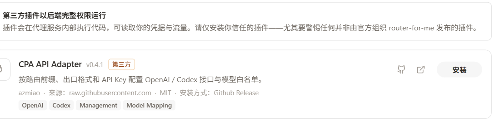
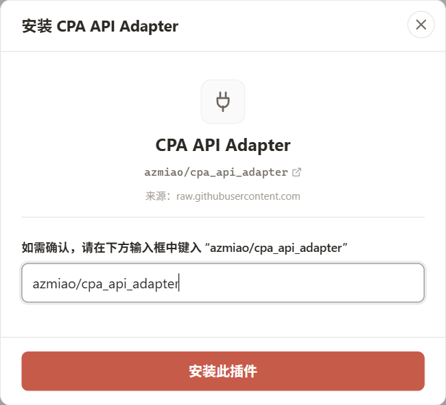
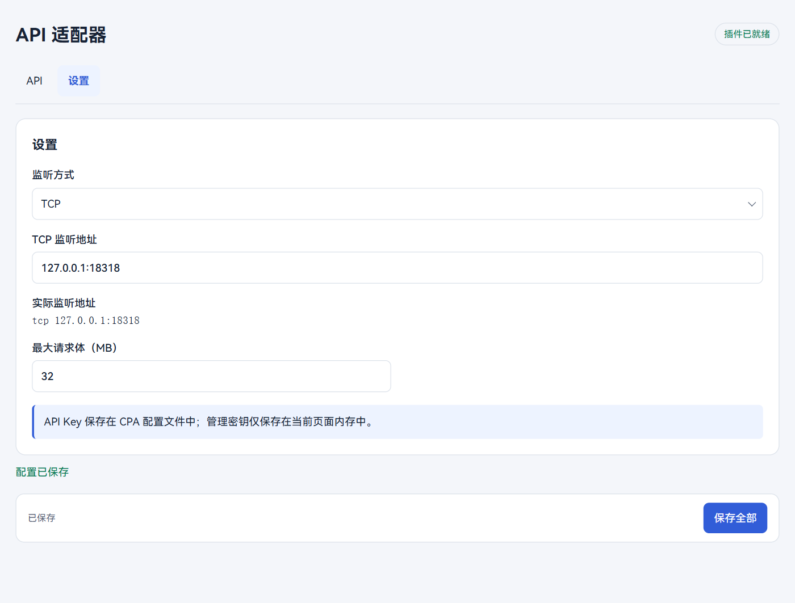
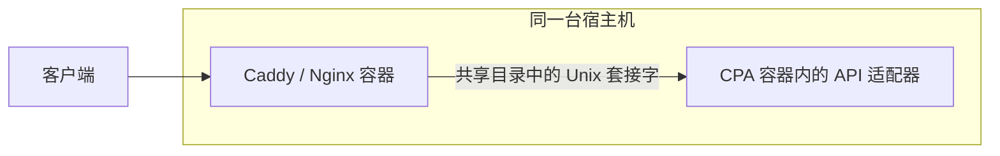
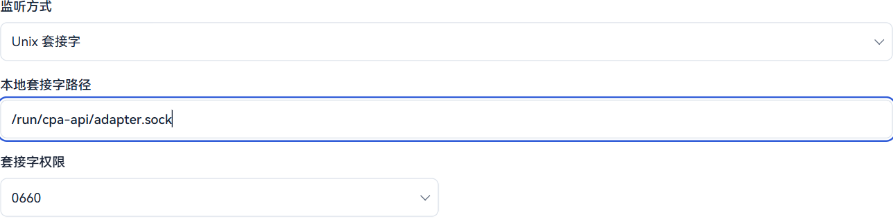
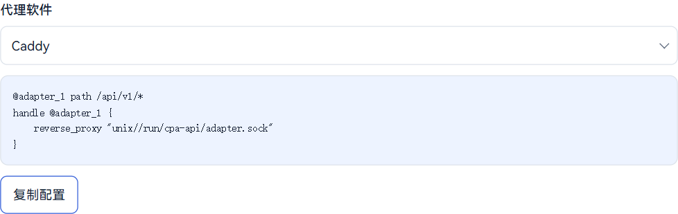
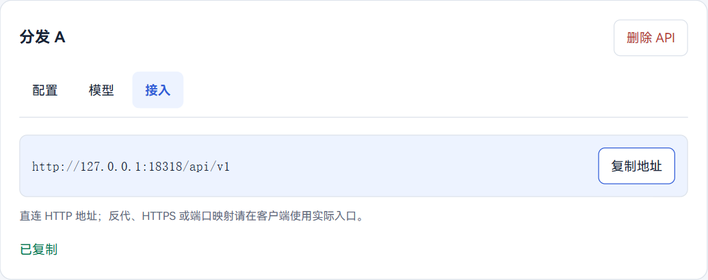
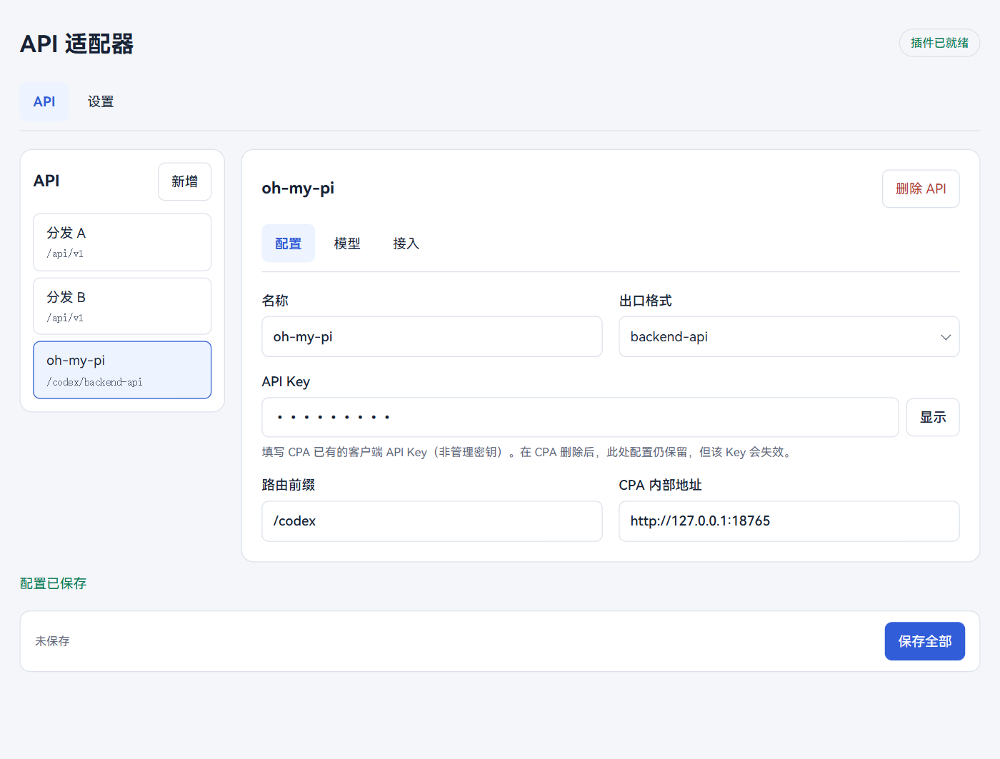

# CPA API Adapter

给 CLIProxyAPI（CPA）增加独立的 API 入口：**给不同 Key 分发不同模型**，或**用 backend-api 接入 oh-my-pi**。

已有能正常使用的 CPA？按下面的页面步骤操作即可，**不用手写 CPA 的 YAML 配置**。

> 截图使用演示密钥和模型。不要照抄截图中的 Key；地址与端口要换成你自己的。

- [从页面安装插件](#1-从页面安装插件)
- [新增 API、选择模型](#2-新增-api选择模型)
- [按部署方式连接](#3-按部署方式连接)
- [把地址交给客户端](#4-把地址交给客户端)
- [接入 oh-my-pi](#5-接入-oh-my-pi可选)
- [遇到问题](#遇到问题)

## 1. 从页面安装插件

### 登录 CPA 管理中心

打开 `http://你的CPA地址:端口/management.html`，例如 `http://127.0.0.1:8317/management.html`。输入 **CPA 管理密钥**，点击「登录」。


### 打开插件开关、添加商店源

1. 左侧「配置面板」→「可视化」→「高级与实验」，展开「插件」。
2. 打开「启用插件系统」。
3. 在「第三方插件源」点击「添加」，粘贴下面的地址：

   ```text
   https://raw.githubusercontent.com/azmiao/cpa_api_adapter/main/registry.json
   ```

4. 点击「保存更改」，在弹出的确认窗口点击「确认保存」。


### 在商店点击安装

1. 左侧「插件」→「商店」，搜索 `cpa-api-adapter`。
2. 找到 **CPA API Adapter**，点击右侧「安装」，选择「最新稳定版」。

[](docs/images/03-store-install.png)

3. 确认仓库是 `azmiao/cpa_api_adapter`，阅读风险提示。只有信任此插件时才继续；按提示输入 `azmiao/cpa_api_adapter`，点击「安装此插件」。



4. 安装完成后，在「已安装」确认插件开关已打开。若页面提示需要重启 CPA，先重启，再刷新管理页面。


左侧会出现 **「API 适配器」**。打开它，再输入同一个 CPA 管理密钥，点击「连接」。后面的 API、模型、监听设置都在这个页面操作。

> 看不到「插件」或可视化开关？先升级到支持动态库插件的 CPA 与新版[官方管理页面](https://github.com/router-for-me/Cli-Proxy-API-Management-Center)。

## 2. 新增 API、选择模型

### 先准备 CPA 客户端 Key

已有 CPA 客户端 Key，可以直接用。没有的话：

1. 回到 CPA「配置面板」→「可视化」→「常用」。
2. 在「客户端 API 密钥」点击「添加 API 密钥」，填写 Key，点击「添加」。名称只是便于识别，可不填。
3. 点击「保存更改」→「确认保存」，复制刚添加的 Key。


**管理密钥用于登录页面；客户端 Key 用于调用模型。两者不能混用。**

### 新增第一条 API

进入「API 适配器」，在「API」页点击「新增」，填写：

| 页面字段 | 怎么填 |
| --- | --- |
| 名称 | 例如「分发 A」，便于自己识别。 |
| 出口格式 | 普通 OpenAI 兼容客户端选 `v1`。 |
| API Key | 粘贴 CPA 已有的客户端 Key。 |
| 路由前缀 | 例如 `/api`，必须带 `/`，不能只填 `/`。 |
| CPA 内部地址 | 通常是 `http://127.0.0.1:8317`，端口换成 CPA 实际监听端口。 |


这里填写的是 **CPA 原有地址**，不是稍后设置的插件端口。截图的演示 CPA 使用 `18765`；你的 CPA 使用什么端口就填什么端口。

### 选择要分发的模型

1. 切到「模型」，点击「获取模型」。
2. 在想开放的模型右侧点击「添加」。
3. 初次使用不用改「CPA 目标模型」和「对外模型 ID」；需要别名时，再修改「对外模型 ID」。


**不添加任何模型表示开放全部模型；添加后只开放所选模型。** 接着按下一节设置连接方式，最后点击「保存全部」。

### 给另一个人分发不同模型

再新增「分发 B」，使用另一个 CPA 客户端 Key，选择另一组模型即可：

| API | 路由前缀 / 出口格式 | 客户端 Key | 开放模型示例 |
| --- | --- | --- | --- |
| 分发 A | /api / v1 | Key A | gpt-5.4 |
| 分发 B | /api / v1 | Key B | claude-sonnet-4-6 |

两个人可以使用同一个 Base URL，但各自带不同的 Key，看到不同的模型列表。**路由前缀、出口格式、Key 三项全部相同的 API 不能重复保存。**

## 3. 按部署方式连接

只选与你实际部署相符的一种。**CPA 内部地址仍指向 CPA 原有端口**；下面设置的是插件如何接受客户端或反代的连接。

### A. CPA 直接运行在宿主机

先用 TCP 跑通，最省事：

1. 「API 适配器」→「设置」，监听方式选 **TCP**。
2. 客户端也在本机：填写 `127.0.0.1:18318`。客户端在另一台内网主机：填写 **CPA 宿主机的内网 IP:18318**，例如 `10.0.0.10:18318`。
3. 点击「保存全部」。确认顶部显示「插件已就绪」，「实际监听地址」是刚保存的 TCP 地址。



本机客户端可以直接连接，不需要额外反代。若已有同机 Caddy / Nginx，也可选择 Unix 套接字并复制反代配置：先创建可用的本机目录，Linux 示例路径 `/run/cpa-api/adapter.sock`，Windows 填本机绝对路径。

**不要把明文 HTTP 插件端口直接暴露到公网。** 公网访问应使用 HTTPS 反代；跨主机连接限制来源，必要时使用 VPN。

### B. CPA 在 Docker，Caddy 等反代也在本机

推荐 **Unix 套接字**，不需要额外发布插件 TCP 端口。



1. **先配置 Docker 挂载。** 给 CPA 和反代容器挂载同一个宿主机目录，两边的容器路径都使用 `/run/cpa-api`。Docker 管理工具可通过挂载设置完成；这一步不能在 CPA 页面完成。

<details>
<summary>使用 Docker Compose？展开查看最少需要增加的内容</summary>

在 Compose 所在目录创建 `./cpa-api-socket`，将下面的挂载合并到现有服务，保留原有配置：

```yaml
services:
  cli-proxy-api:
    volumes:
      - ./cpa-api-socket:/run/cpa-api
  caddy:
    volumes:
      - ./cpa-api-socket:/run/cpa-api:ro
```

将服务名换成你实际使用的名称，应用 Compose 改动。目录需让 CPA 可写、反代可访问；权限 `0660` 的套接字要求两侧进程具有共同用户组。

</details>

2. 回到插件「设置」，选择 **Unix 套接字**；路径填写 `/run/cpa-api/adapter.sock`，权限保持 `0660`，点击「保存全部」。



3. 在当前 API 的「接入」页选择 Caddy 或 Nginx，点击「复制配置」。放入已有反代站点，保留原有 CPA 转发规则，检查配置后重载反代。



相同 Base URL 的多个 Key **只需一份反代规则**；其他路径的 API 再增加对应规则。保存后在「设置」确认实际监听状态，目录挂载与权限正确后反代才能连接。

### C. CPA 在 Docker，反代在另一台服务器

不同主机不能共用 Unix 套接字，使用 **TCP**：

1. 插件「设置」选 **TCP**，监听地址填 `0.0.0.0:18318`，点击「保存全部」。这里的 `0.0.0.0` 表示监听容器接口，不是给远端反代填写的连接地址。
2. 在 Docker 管理工具中，把容器 `18318` 端口发布到 CPA 宿主机的内网接口。不要删除 CPA 原有端口。

<details>
<summary>使用 Docker Compose？展开查看端口发布示例</summary>

假设 CPA 宿主机内网 IP 是 `10.0.0.10`，向现有 CPA 服务追加：

```yaml
services:
  cli-proxy-api:
    ports:
      - "10.0.0.10:18318:18318"
```

换成实际服务名和宿主机 IP，应用 Compose 改动。插件的「CPA 内部地址」通常仍是 `http://127.0.0.1:8317`，不要改为 `18318`。

</details>

3. **到远端反代服务器配置连接目标**：CPA 宿主机 IP 加发布端口，例如 `10.0.0.10:18318`。不是反代服务器自己的 IP，也不是 `127.0.0.1` 或 `0.0.0.0`。

<details>
<summary>远端 Caddy 示例：放入已有站点块，保留原有 CPA 转发</summary>

```caddyfile
@adapter path /api/v1/* /codex/backend-api/*
handle @adapter {
    reverse_proxy 10.0.0.10:18318
}
```

修改 IP 和 API 路径后检查配置、重载 Caddy。Nginx 的 `proxy_pass` 使用 `http://10.0.0.10:18318`，不附加 URI；保留认证头、WebSocket 升级，并关闭 SSE 缓冲和缓存。

</details>

4. 防火墙只允许反代服务器访问插件端口。客户端使用反代的 HTTPS 域名，不使用容器监听地址。TCP 模式不提供一键反代配置，远端反代由你自行配置。

## 4. 把地址交给客户端

1. 回到当前 API 的「接入」页，点击「复制地址」。
2. 在客户端填写 **Base URL + 这个 API 对应的 CPA 客户端 Key**。
3. 获取客户端模型列表，确认只显示选中的模型，再发起请求。



本机 TCP 示例：`http://127.0.0.1:18318/api/v1`。使用反代时，改为实际入口，例如 `https://api.example.com/api/v1`。

Unix 预览地址按管理页面的 Origin 生成，配置好反代后才能使用；TCP 通配绑定使用管理页面主机名预览。**公网域名、HTTPS 或 Docker 发布端口不同时，客户端填写实际可达的入口。**

## 5. 接入 oh-my-pi（可选）

只做模型分发，可以跳过本节。需要覆盖 oh-my-pi 的 Codex 提供商时：

1. 在插件新增 API，名称可填 `oh-my-pi`，路由前缀填 `/codex`，出口格式选择 **`backend-api`**。
2. 填 CPA 已有的客户端 Key 和内部地址，在「模型」中获取并添加需要的模型，点击「保存全部」。高级模型能力初次使用可不修改，先沿用 CPA。



3. 到「接入」复制地址；使用 Unix / 反代时，补齐该路径的反代规则。
4. 在 **客户端**的 `~/.omp/agent/models.yml` 合并以下内容。这里是 oh-my-pi 的文件，不是 CPA 配置：

```yaml
providers:
  openai-codex:
    baseUrl: "https://api.example.com/codex/backend-api"
    api: openai-codex-responses
    apiKey: CPA_API_KEY
```

把 `baseUrl` 换成实际接入地址，并将 `CPA_API_KEY` 环境变量设为对应的 CPA 客户端 Key。运行 `omp models openai-codex --json` 查看模型；需要刷新时运行 `omp models refresh`。

插件提供 Codex 风格目录、模型别名与能力配置，以及 Responses 的 HTTP / SSE / WebSocket 和 compact 转发。上游仍须支持相应模型与接口；**不会把 Chat Completions 转换为 Responses**。

## 遇到问题

| 现象 | 先检查这里 |
| --- | --- |
| 安装提示 GitHub 429 | 是下载限流，不要反复点安装；等待提示的时间后重试。需要认证时参考 [CPA 配置文档](https://help.router-for.me/configuration/options)。 |
| 「获取模型」失败 / 返回 401 | Key 必须是 CPA 已有的客户端 Key；CPA 内部地址必须指向 CPA 原有端口。 |
| 已保存，但插件未就绪 | 在「设置」看实际监听状态；检查端口占用、目录是否存在，再保存。 |
| Unix 反代连不上 | 两个容器是否挂载同一目录？CPA 能否写入、反代是否具有套接字访问权限？ |
| TCP 远端连不上 | 反代连接的是 CPA 宿主机 IP:发布端口吗？检查 Docker 端口发布与防火墙。 |

- 在 CPA 删除 Key 后，插件中的 API 配置仍保留，但该 Key 会失效。
- 模型白名单只限制插件入口；若不希望用户绕过插件，需自行限制直接访问 CPA 原有接口。
- 旧 `apis[].public_base_url` 在 `v0.4.1` 起加载时自动清理，升级后「保存全部」可写回干净配置。

截图来自隔离演示环境：CPA `8.0.78`、官方管理页面 `1.28.3`、插件 `0.4.1`。安装、API 配置及 TCP 模型目录已实际操作；Linux / Docker 的 Unix 图片展示字段填写与反代预览，未在 Docker 中执行部署或调用真实模型推理。

<details>
<summary>开发者：从源码构建</summary>

需要 Go 1.24+ 和目标平台 C 编译器：

```sh
go test ./internal/adapter
CGO_ENABLED=1 go build -trimpath -buildvcs=false -buildmode=c-shared \
  -o dist/cpa-api-adapter.so ./cmd/cpa-api-adapter
python scripts/smoke_plugin.py dist/cpa-api-adapter.so 0.4.1
```

Windows / macOS 使用对应动态库扩展名；Release 工作流负责多平台构建与打包。

</details>

