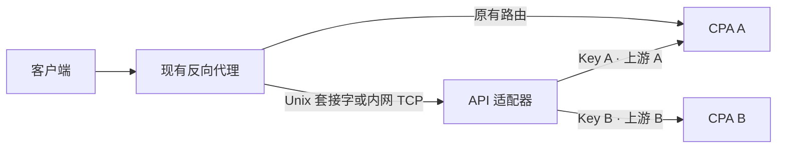

# CPA API Adapter

CLIProxyAPI（CPA）的原生插件。按客户端 API Key 分别保存上游地址、路由前缀、出口格式和模型映射，提供 OpenAI v1 与 Codex backend-api 接口；可通过本地 Unix 套接字或独立 TCP 端口接入。

## 配置和路由

- 每个 API Key 对应一份独立配置，密钥和路由前缀不能重复。
- 新建 API 的路由前缀为空；保存前必须填写，例如 /work。空字符串、根路径和不规范路径均不接受。
- 出口格式可选 v1 或 backend-api，完整 Base URL 为「路由前缀 / 出口格式」。出口格式控制对外及 CPA 上游接口路径，不进行 Chat Completions 与 Responses 之间的协议转换。
- 未配置模型映射时，暴露该 Key 在对应 CPA 上游可见的全部模型。
- 配置映射后，仅暴露映射中的对外模型 ID；未配置模型和被别名替换的目标 ID不能绕过白名单直接调用。不存在的目标不会回退到全部模型；冲突别名拒绝路由。
- API Key 必须是对应 CPA 上游的有效客户端密钥，不是插件另行签发的虚拟密钥。模型别名不会改变 CPA 的账号选择策略。

| 出口格式 | Base URL 示例 | 模型目录 | 推理接口 |
| --- | --- | --- | --- |
| v1 | https://example.com/work/v1 | /models，标准 object/data 格式 | CPA 的 /v1/* 接口，例如 /chat/completions、/responses；/responses 支持 WebSocket |
| backend-api | https://example.com/personal/backend-api | /models 或 /codex/models，Codex models/slug 格式 | /codex/responses（HTTP / SSE / WebSocket）、/codex/responses/compact |

配置模型白名单后，带请求体的非 GET / DELETE 请求必须使用 JSON 或 multipart/form-data 并明确指定 model。WebSocket 首次创建响应必须指定模型；后续 create / append 可沿用已验证的模型。重复 JSON 字段或 multipart model 字段拒绝转发。模型别名会在普通 JSON、SSE、WebSocket 响应中恢复。

白名单只约束插件路由，不会改变 CPA 原有 /v1 路由的权限。若需要全局禁止某个 Key 调用其他模型，还需在 CPA 或反向代理中限制绕过插件的访问。

## 工作方式

插件默认使用本地 Unix 域套接字，不新增 TCP 端口；也可切换为 TCP 模式，由插件直接监听独立的 HTTP 端口，方便跨服务器反代。两种模式互斥，所有 API 共用同一个监听端点。插件验证「路由 + API Key」后调用该 API 对应的 CPA 上游；其余原有 CPA 路由不变。



CPA 标准插件接口不能直接添加普通客户端路由。本插件自行创建 Unix / TCP 监听，管理页面仍由 CPA 的管理接口提供。Unix 模式需使用本机反向代理；TCP 模式可由远端 Nginx / Caddy 转发，也可在可信网络内直接访问。公网接入建议由反向代理负责 HTTPS 和访问控制。

## 安装和更新

### 插件商店

商店源地址：

```text
https://raw.githubusercontent.com/azmiao/cpa_api_adapter/main/registry.json
```

1. 在 CPA 管理中心添加该商店源，或合并到 CPA 配置的 plugins.store-sources，搜索 cpa-api-adapter 后安装。
2. 商店源必须已推送到 main，仓库必须已有对应新插件 ID 的正式 Release。仅改名仓库不会重新打包旧版 Release。
3. 更新时会校验发布包 SHA-256；如 CPA 提示需要重启，请重启后检查插件状态。安装不会自动打开全局 plugins.enabled。

服务器需能访问 GitHub。遇到 GitHub API 429 时按 Retry-After 等待；持续限流可参考 [CPA 插件商店认证配置](https://help.router-for.me/configuration/options.html)，通过环境变量提供权限受限的 Token，不要将 Token 写入配置文件或提交到仓库。

### 手动安装

从 [GitHub Releases](https://github.com/azmiao/cpa_api_adapter/releases) 下载对应平台 ZIP。ZIP 根目录为动态库；Linux 使用 cpa-api-adapter.so，macOS 使用 cpa-api-adapter.dylib，Windows 使用 cpa-api-adapter.dll。将其复制到 CPA 插件目录，并合并配置：

```yaml
plugins:
  enabled: true
  dir: plugins
  configs:
    cpa-api-adapter:
      enabled: true
```

重启 CPA，在「API 适配器」菜单打开管理页面。

## WebUI

- API 页签：新建、选择或删除 API。每个 API 下有「配置」「模型」「接入」页签。
- 配置：名称、API Key、路由前缀、CPA 内部地址、出口格式、可选的对外 Base URL。
- 模型：读取当前 API 的上游目录，选择暴露模型，设置别名、显示名与能力。未添加模型时显示「全部模型」。获取目录使用当前页面配置，无需先保存。
- 接入：复制当前 API 的 Base URL 和反向代理配置。多个 API 的 Caddy 示例需合并 matcher 的 path 列表，或使用不同 matcher 名称；Nginx 的 map 只需声明一次。
- 设置页签：监听方式、TCP 监听地址或 Unix 套接字路径与权限、实际监听地址、请求体上限。
- 保存全部：一次写入各 API 和通用配置，并确认插件重新加载。页面中的 API 切换不会丢失未保存配置。

管理密钥仅保存在当前页面内存中，刷新后需要重新输入。客户端 API Key 必须持久化在 CPA 配置文件中，界面默认遮蔽；请限制配置文件和备份的读取权限，并仅在可信的 HTTPS 或本机管理页面输入密钥。

### 设置页字段说明

| 页面字段 | 配置键 / 默认值 | 解释与填写方式 |
| --- | --- | --- |
| 监听方式 | listen_mode；默认 unix | unix 适合代理与 CPA 位于同一主机，或同一主机上共享套接字目录的容器；tcp 适合跨服务器接入。只启用所选的一种监听方式，所有 API 共用该端点。旧配置省略此字段时继续使用 Unix。 |
| TCP 监听地址 | listen_address；预填 127.0.0.1:18318 | 仅 TCP 模式生效。填写 IP:端口，IPv6 使用 [::1]:18318 这样的括号格式；端口范围为 1–65535，不能填 0、URL、主机名或带接口区域的 IPv6 地址。IP 必须属于 CPA 进程所在的主机或容器网络空间；不要填写另一台 Nginx 的 IP。127.0.0.1 / [::1] 只允许本机连接；跨服务器时填写 CPA 的内网 IP。低于 1024 的端口通常需要额外权限，不能复用 CPA 或其他进程已占用的同一地址与端口。 |
| 本地套接字路径 | socket_path；默认系统临时目录下的 cpa-api-adapter.sock | 仅 Unix 模式生效。必须是绝对路径，父目录需预先创建，插件不会自动创建目录。反代进程必须能访问同一个套接字文件；独立容器需共享目录。不能填 URL，也不能跨主机共享这个套接字。已有普通文件或其他服务的活动套接字不会被覆盖；失效套接字会按安全检查结果清理。 |
| 套接字权限 | socket_mode；默认 0660 | 仅 Unix 模式生效。0600 只允许所有者连接；0660 允许所有者和同组用户，适合 CPA 与反代使用共同用户组；0666 允许所有本机用户连接，不建议多租户环境使用。目录也需具备相应访问权限。Windows 不执行 Unix chmod，使用文件系统 ACL。连接权限不替代客户端 API Key 鉴权。 |
| 最大请求体（MB） | max_body_mb；默认 32 | 所有 API 共用，允许 1–512 的整数。限制单个请求体大小，包括上下文、图片和上传文件，不是 token 数或上下文窗口大小。Nginx / Caddy、CPA 及其他中间层的限制不能小于此值；调高后需同步反代配置。 |
| 实际监听地址 | 只读状态，无配置键 | 显示插件当前真正绑定的监听方式与地址，不是正在编辑的预览值。未保存修改不会改变它；启动失败或停止时显示「未监听」。通配绑定在某些系统上可能显示为 [::]:端口，应使用可达的具体 IP 作为连接目标。 |

TCP 模式中的 0.0.0.0 和 [::] 是通配绑定地址，可能开放多个接口；它们不是远端连接目标。只有确实需要容器端口发布或多接口监听时才使用，并用防火墙 / VPN 限制访问。

保存会检查配置并重新配置监听；地址不变时复用已有监听器，切换方式或地址时先尝试绑定新端点。端口占用、IP 不属于当前网络空间、权限不足等问题会明确报错，插件不继续在旧端点接受新请求，避免旧访问策略继续生效。此时配置已经写入，页面显示「已保存，未启动」；修正地址后再次保存即可恢复。修改配置会关闭现有 WebSocket；切换监听时旧 HTTP 连接会短暂排空，客户端需能重新连接。

### API 配置字段说明

| 页面字段 | 配置键 / 新建时默认值 | 解释与填写方式 |
| --- | --- | --- |
| 名称 | name；空 | 用于页面中识别 API，不参与路由或鉴权。留空时页面显示 API 序号。 |
| API Key | api_key；空，必填 | 填写对应 CPA 上游的有效客户端密钥，不是管理密钥，也不是环境变量名称。客户端调用这个 API 时需携带同一个密钥。每个 Key 只能对应一份配置，并持久化在 CPA 配置文件中；应限制文件及备份的读取权限。 |
| CPA 内部地址 | upstream；http://127.0.0.1:8317 | 插件访问 CPA 原有接口的地址，每个 API 可不同。同一 CPA 进程通常填写本机地址；容器网络可使用服务名。支持 HTTP / HTTPS，但不能带账号密码、查询参数或片段。不能指向插件自身端口或适配路由，否则会循环转发。它与对外 Base URL、Nginx 的上游地址是三个不同概念。 |
| 路由前缀 | prefix；空，必填 | 必须是规范的非根绝对路径，例如 /work；不能留空或填写 /。完整路径为「前缀 / 出口格式」，例如 /work/v1。各 API 前缀不能重复。修改后需同步客户端地址及反代规则；/omp 仅作为显式填写的普通前缀，不再是默认值。 |
| 出口格式 | format；新建 API 预选 v1 | v1 使用标准 OpenAI 模型目录与 /v1 推理接口；backend-api 使用 Codex 目录与 /backend-api/codex/responses 等接口。配置文件中应显式填写格式。这里只选择接口格式，不转换 Chat Completions 与 Responses 请求协议。 |
| 对外 Base URL（可选） | public_base_url；空 | 客户端实际使用的完整 Base URL，例如 https://api.example.com/work/v1；必须以该 API 的完整路由结尾，不能带账号、查询参数或片段。仅用于显示和复制，不改变监听、上游或反代。Unix 模式留空时使用管理页面的 Origin；TCP 模式留空时显示当前代理连接地址对应的 HTTP URL。公网域名、HTTPS 或管理页面与客户端地址不同时，应显式填写。 |

### 模型字段说明

| 页面字段 | 配置键 | 解释与填写方式 |
| --- | --- | --- |
| CPA 目标模型 | mappings[].target | 对应上游目录中的完整模型 ID，可包含账号前缀和斜杠。必须存在且唯一。 |
| 对外模型 ID | mappings[].id | 客户端发现和调用的模型 ID。与目标相同时是原 ID 的白名单项，不同时是别名。每个 API 内不能重复，别名也不能与该上游的其他实际模型 ID 冲突。 |
| 显示名称（可选） | display_name | 修改目录中的显示名称，不改变目标路由、账号或计费来源。 |
| 上下文窗口 | context_window | 可选的上下文 token 数；留空沿用 CPA 信息，不是请求体 MB 限制。 |
| 最大上下文窗口 | max_context_window | 可选的最大上下文 token 数；留空沿用 CPA 信息。 |
| 最大输出 token | max_tokens | 可选的输出 token 上限信息；留空沿用 CPA。客户端可能不读取此字段。 |
| 输入类型 | input_modalities | 沿用 CPA、仅文本、文本和图片。只填写已确认的真实能力。 |
| 推理等级 | reasoning_levels | 不选择时沿用 CPA；选择后覆盖目录信息。可选 none、minimal、low、medium、high、xhigh、max、ultra；需要声明不支持推理时仅选 none。 |
| 默认推理等级 | default_reasoning | 必须包含在已选的推理等级中。留空时使用第一个所选等级；没有选择等级时沿用 CPA。 |

模型能力字段只修改目录元数据，不会使真实模型获得额外能力，客户端也可能忽略这些信息。未添加映射时暴露全部；添加任何映射后，只暴露映射项。要保留原 ID，请添加 id 与 target 相同的条目。

### 接入页与管理密钥

- 代理软件：选择 Nginx 或 Caddy，只控制示例生成，不会替你修改或重载代理。
- 代理连接地址：仅 TCP 模式显示，格式为 IP 或主机名加端口，例如 10.0.0.10:18318 或 cpa.internal:18318。它是 Nginx / Caddy 连接插件的目标，不是监听绑定地址，也不是客户端公网 URL。默认取可直接连接的监听地址；通配绑定时需填写 CPA 的实际内网地址。此字段仅保存在当前页面，不写入 CPA 配置，刷新页面会重置；修改监听方式或绑定地址也会重置。不能填写 0.0.0.0、[::]、URL 或代理配置语句。
- Base URL 与复制配置：根据当前页面输入生成，未保存时只是预览。对外 Base URL 非空时优先显示它；TCP 连接目标缺失或无效时，不生成可复制的代理配置。跨服务器示例使用 HTTP，上游加密需通过 VPN 或其他受控链路提供。
- 管理密钥：只用于登录插件管理页面，填 CPA 管理密钥，不是客户端 API Key。仅保存在当前页面内存中，刷新后重新输入；不要把它填入 API Key 或客户端配置。
- enabled、priority、store 是 CPA 宿主管理的字段。插件接受这些字段，但不将商店元数据当作 API 配置；不要为修复注册问题删除 store，否则会影响宿主的版本管理。


## 配置示例

以下为插件配置内容；合并到 plugins.configs.cpa-api-adapter，不要覆盖其他插件。两个 API 可使用同一个对外模型 ID，但映射到不同的目标。

```yaml
listen_mode: unix
listen_address: "127.0.0.1:18318"
socket_path: /run/cpa-api/adapter.sock
socket_mode: "0660"
max_body_mb: 32
apis:
  - name: 工作
    api_key: CPA_CLIENT_KEY_A
    upstream: http://127.0.0.1:8317
    prefix: /work
    format: v1
    public_base_url: ""
    mappings:
      - id: my-model
        target: account-a/gpt
        display_name: 工作模型
  - name: 个人
    api_key: CPA_CLIENT_KEY_B
    upstream: http://127.0.0.1:8317
    prefix: /personal
    format: backend-api
    public_base_url: ""
    mappings:
      - id: my-model
        target: account-b/gpt
```

api_key 填写实际客户端密钥，不进行环境变量名称替换。public_base_url 仅用于页面展示和复制，填写时须以当前 API 的完整路由结尾。每个 upstream 支持 HTTP / HTTPS；HTTP 会明文传输密钥和内容，只应在可信网络使用。

新安装不创建任何 API，默认使用 Unix；TCP 地址预填 127.0.0.1:18318，但只有切换到 TCP 后才生效。默认套接字为系统临时目录下的 cpa-api-adapter.sock，权限为 0660，请求体上限为 32 MB。修改前缀、格式或监听端点后，需要同步代理配置及客户端地址；保存插件配置不会自动修改反代、防火墙或容器端口发布。

## 容器部署

Unix 模式下，CPA 与代理位于同一主机的不同容器时，将同一宿主机目录挂载到两侧。不同服务器不能使用此方法共享 Unix 套接字，应使用 TCP 模式。共享目录示例：

```yaml
services:
  cli-proxy-api:
    volumes:
      - /run/cpa-api:/run/cpa-api
  nginx: # Caddy 同理
    volumes:
      - /run/cpa-api:/run/cpa-api:ro
```

启动前在宿主机创建目录并设置共享权限：

```sh
mkdir -p /run/cpa-api
chown root:<代理组> /run/cpa-api
chmod 0750 /run/cpa-api
```

目录需对 CPA 进程可写、对代理进程可访问；0660 套接字需同组权限。修改 Compose 后按现有运维流程重建相关容器。在设置页签填写 /run/cpa-api/adapter.sock。CPA 内部地址通常为 http://127.0.0.1:8317，也可根据容器网络使用 http://cli-proxy-api:8317。

## 反向代理

以下为 Unix 模式：保留已有 CPA 站点和端口，只新增插件路由。两个 API 共用一个套接字；实际路径以配置为准。跨服务器使用后面的 TCP 部署示例。

### Caddy

放入已有 CPA 站点块：

```caddyfile
@adapter path /work/v1/* /personal/backend-api/*
handle @adapter {
    reverse_proxy unix//run/cpa-api/adapter.sock
}

# 保留原有 CPA 转发
handle {
    reverse_proxy cli-proxy-api:8317
}
```

Windows 可使用 reverse_proxy "unix/C:/path/to/adapter.sock"。Caddy 自动处理 WebSocket 升级；不要缓冲 SSE。

### Nginx

map 和 upstream 放在 http 块，location 放在现有 CPA 的 server 块。proxy_pass 不指定 URI，保留原请求路径与查询参数：

```nginx
map $http_upgrade $adapter_connection_upgrade {
    default upgrade;
    '' close;
}
upstream cpa_api_adapter {
    server unix:/run/cpa-api/adapter.sock;
}

location ~ ^/(work/v1|personal/backend-api)/ {
    client_max_body_size 32m;
    proxy_pass http://cpa_api_adapter;
    proxy_http_version 1.1;
    proxy_set_header Host $host;
    proxy_set_header Upgrade $http_upgrade;
    proxy_set_header Connection $adapter_connection_upgrade;
    proxy_buffering off;
    proxy_cache off;
    proxy_request_buffering off;
    proxy_read_timeout 3600s;
    proxy_send_timeout 3600s;
}
```

修改后运行 nginx -t，通过后按现有运维流程重载。不要缓存模型目录，须保留客户端认证头和查询参数。请求体限制不得小于插件设置。已有更高优先级 location 时，使用 WebUI 生成的每 API 独立 location ^~ 规则。Windows 可选择 Caddy。

## TCP 跨服务器部署

假设 CPA 位于服务器 A（内网地址 10.0.0.10），公网 Nginx 位于服务器 B。A 不需要再安装反代桥接，插件可以直接监听内网端口。

### 1. 配置插件

在设置页选择 TCP，填写 10.0.0.10:18318；或将以下通用字段合并到插件配置，不要覆盖 apis：

```yaml
listen_mode: tcp
listen_address: "10.0.0.10:18318"
max_body_mb: 32
```

每个 API 的 CPA 内部地址仍指向 CPA 服务，例如 http://127.0.0.1:8317。不要改成 18318。确认设置页的实际监听地址已变为 tcp 10.0.0.10:18318，并在防火墙中仅允许 B 的实际源 IP 或受控 VPN 网段访问。

### 2. 配置远端 Nginx

将 map 和 upstream 放在 B 的 http 块，将 location 放在已有公网 CPA 站点的 server 块；已有同名 map 时复用，不要重复声明。原有 CPA 转发规则保持不变：

```nginx
map $http_upgrade $adapter_connection_upgrade {
    default upgrade;
    '' close;
}
upstream cpa_api_adapter_tcp {
    server 10.0.0.10:18318;
}

location ~ ^/(work/v1|personal/backend-api)/ {
    client_max_body_size 32m;
    proxy_pass http://cpa_api_adapter_tcp;
    proxy_http_version 1.1;
    proxy_set_header Host $host;
    proxy_set_header Upgrade $http_upgrade;
    proxy_set_header Connection $adapter_connection_upgrade;
    proxy_buffering off;
    proxy_cache off;
    proxy_request_buffering off;
    proxy_read_timeout 3600s;
    proxy_send_timeout 3600s;
}
```

实际 API 前缀不同就修改匹配规则；已有更高优先级 location 时，使用接入页生成的每 API 独立 location ^~ 规则。proxy_pass 不附加 URI，保留完整路径和查询参数。检查 nginx -t 后再重载。

Caddy 在已有站点块中使用：

```caddyfile
@adapter path /work/v1/* /personal/backend-api/*
handle @adapter {
    reverse_proxy 10.0.0.10:18318
}
```

客户端仍使用 B 的公网地址，例如 https://api.example.com/work/v1。可将该完整地址填写到对应 API 的「对外 Base URL」；18318 是代理与插件之间的端口，不必暴露给公网客户端。

### 3. CPA 在容器中运行

常规桥接网络的容器不能绑定宿主机的 10.0.0.10，应在插件中监听 0.0.0.0:18318，并只向宿主机内网接口发布端口：

```yaml
services:
  cli-proxy-api:
    # 合并到现有 ports，不要移除 CPA 原有端口
    ports:
      - "10.0.0.10:18318:18318"
```

此时接入页的代理连接地址填写 10.0.0.10:18318，而不是 0.0.0.0。TCP 模式不需要给远端 Nginx 挂载套接字目录。使用 host 网络时按宿主机地址绑定即可。Docker 端口发布可能绕过普通主机防火墙规则，应按实际容器网络 / 防火墙链限制来源。

### 4. 网络与故障检查

- TCP 监听提供 HTTP，不提供 TLS。B 的公网 HTTPS 不会自动加密 B 到 A 的这一段；不可信网络应使用 VPN / 受控加密链路，不要在公网裸跑 HTTP。
- 远端连接被拒绝：检查实际监听状态、是否误用回环地址、端口发布和防火墙。远端不能连接 A 的 127.0.0.1，也不能把通配地址当作目标。
- 提示无法监听：检查端口是否占用、IP 是否属于当前网络空间及进程权限。修正后重新保存；配置已写入但未启动时，管理页面仍通过 CPA 的管理接口访问。
- 返回 401：确认客户端 Key 属于当前路由的 API，并确认 Nginx 保留认证头。不要改用 CPA 管理密钥。
- 其他 CPA /v1 路由仍由原有服务处理；插件的模型白名单不会自动限制绕过插件的访问。

## 客户端

OpenAI 兼容客户端使用 https://<原CPA地址>/work/v1 作为 Base URL，并传入工作 API 对应的客户端 Key。

OMP 使用 backend-api API；在 ~/.omp/agent/models.yml 合并：

```yaml
providers:
  openai-codex:
    baseUrl: "https://<原CPA地址>/personal/backend-api"
    api: openai-codex-responses
    apiKey: CPA_API_KEY
```

CPA_API_KEY 是 OMP 使用的客户端密钥环境变量。运行 omp models openai-codex --json 检查发现结果；旧缓存可用 omp models refresh 刷新。

## 从旧版迁移

0.2.0 是配置格式和插件 ID 的破坏性变更，不兼容旧的全局 prefix、upstream、public_base_url、mappings 配置。

1. 备份 CPA 配置及旧模型映射。停用旧插件 cpa-omp-adapter，安装 cpa-api-adapter；不要同时保留两个适配器处理同一外部路由。
2. 将原全局上游、前缀、对外地址和模型映射移入 apis 中的一项，并填写对应 CPA 客户端 api_key 和 format: backend-api。需要保持原 URL 时可显式填写 prefix: /omp；它不再是默认值。
3. 旧映射原本会追加到全部模型；新版一旦配置映射就只暴露配置项。若仍需暴露原模型，应逐项添加 identity 映射；若不需要别名则清空 mappings。
4. 将插件配置项、商店源和动态库名称更新为新 ID，并同步套接字、反向代理与客户端 Base URL。确认新版可用后移除旧插件动态库和旧配置项。

旧格式会明确报错，不会静默丢弃配置或恢复默认路由。仓库改名后 GitHub 通常会重定向旧链接，但应更新源地址和 remote；旧 Release 资产不会自动改名。

## 构建与验证

需要 Go 1.24+ 和目标平台 C 编译器。源码命令：

```sh
go test ./internal/adapter
CGO_ENABLED=1 go build -trimpath -buildvcs=false -buildmode=c-shared \
  -o dist/cpa-api-adapter.so ./cmd/cpa-api-adapter
python scripts/smoke_plugin.py dist/cpa-api-adapter.so 0.3.0
python scripts/package_release.py 0.3.0 linux_amd64 dist/cpa-api-adapter.so
```

Windows / macOS 使用相应扩展名和平台参数。Release 工作流构建五个平台并检查 CPA 原生 ABI，随后打包、生成 checksums.txt。dist/ 中的本地构建产物不加入 Git。
