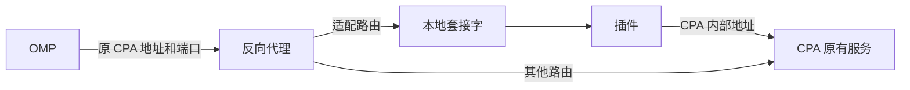

# CPA OMP Adapter

CLIProxyAPI（CPA）的原生插件：让 oh-my-pi（OMP）以 `openai-codex` 协议发现 CPA 模型，并可在 CPA 管理页面中设置模型别名、显示名和能力。

## 工作方式

插件使用 **本地 Unix 域套接字**与现有反向代理通信，不新增对外 TCP 端口。反向代理把原 CPA 地址下的 `/omp/backend-api/...` 转给插件；插件再使用 CPA 客户端 API Key 调用同一 CPA 实例。普通 CPA 路由保持原样。



## 前提条件

- 需要已配置反向代理（Caddy 或者 Nginx）。插件不能通过 CPA 的标准插件接口直接添加普通客户端路由，因此需要通过反向代理将 `/omp/backend-api` 下的请求转发到插件的 Unix 套接字，插件再调用 CPA 原有接口；其他请求仍直接转发到 CPA。

## 安装

### 通过插件商店安装和更新

商店源地址：

```text
https://raw.githubusercontent.com/azmiao/cpa_omp_adapter/main/registry.json
```

1. 在 CPA 管理中心的插件商店添加上述源地址；如果界面没有添加入口，可将它合并到 CPA 配置的 `plugins.store-sources`。保存配置并刷新插件商店，搜索 `cpa-omp-adapter`，选择本商店源后点击安装。商店源清单必须已推送到 `main`，并且仓库已有正式 Release，才能下载安装。
2. 已安装时，商店会根据 GitHub 最新正式 Release 检查更新；有新版本时点击更新。安装或更新会校验发布包的 SHA-256；如界面提示需要重启，请重启 CPA 后再检查插件状态。
3. 添加商店源和安装插件都不会自动打开全局 `plugins.enabled`。CPA 所在服务器或容器需要能够访问商店源及 GitHub Release。

若安装或检查更新时遇到 GitHub API `429` 限流，请按响应的 `Retry-After` 等待；如经常遇到限流，可参考 [CPA 插件商店认证配置](https://help.router-for.me/configuration/options.html)用环境变量提供权限受限的 GitHub Token，不要把 Token 写入配置文件或提交到仓库。

### 手动安装

从 [GitHub Releases](https://github.com/azmiao/cpa_omp_adapter/releases) 下载对应平台 ZIP；ZIP 根目录即为动态库，并提供 `checksums.txt` 校验。将动态库命名为 `cpa-omp-adapter` 并复制到 CPA 的插件目录：Linux 使用 `.so`、macOS 使用 `.dylib`、Windows 使用 `.dll`。也可按本文末尾说明从源码构建；本地 `dist/` 不加入 Git。

手动安装后，确保全局插件开关与该插件均已启用，然后重启 CPA。已有配置请合并，不要覆盖其他插件：

```yaml
plugins:
  enabled: true
  dir: "plugins"
  configs:
    cpa-omp-adapter:
      enabled: true
```

## 部署配置

### 1. 配置适配器

确保 CPA 已有 **管理密钥**。通过 CPA 管理中心的「OMP 适配器」菜单打开插件进行配置：

- 本地套接字路径：是反向代理程序和本插件都要能访问的路径。非容器化部署或 CPA 与代理同容器时通常保持默认；独立容器部署需要映射宿主机目录，并按下文修改路径。
- CPA 内部地址：是本插件访问 CPA 的 URL，常规容器化部署保持默认 `http://127.0.0.1:8317` 即可；若 CPA 需经容器网络访问，可以填入服务名，例如 `http://cli-proxy-api:8317`。
- 适配路由前缀：一般默认即可，只影响 OMP 客户端访问本插件的 URL。
- 对外 Base URL（可选）：一般不要填写；需要独立设置对外 URL 时再使用。

### 2. 配置模型映射

确保 CPA 已有至少一个 **客户端 API Key**。通过 CPA 管理中心的「OMP 适配器」菜单打开插件进行配置：

- 不添加映射时，默认返回 CPA 已有的全部模型。
- 填写客户端 API Key 后，可以获取 CPA 已有模型。
- 带前缀的模型 ID（例如 `gpt/gpt-6.1-terra`）通常可以保留斜杠，直接作为 OMP 的完整模型 ID 使用；如需避免斜杠或自定义名称，可将「OMP 可见模型 ID」设置为不含 `/` 的别名，例如 `gpt-gpt-6.1-terra`。

### 3. 容器部署特殊配置

(1) Docker Compose 部署时，将固定的宿主机目录同时挂载到 CPA 与代理容器。以下示例使用宿主机 `/run/cpa-omp` 目录，两个容器内路径也统一为 `/run/cpa-omp`。

```yaml
services:
  cli-proxy-api:
    # 其余原有配置保持不变
    volumes:
      - /run/cpa-omp:/run/cpa-omp             # volumes 下新增这一行，把容器里的 /run/cpa-omp 挂载到宿主机的 /run/cpa-omp

  nginx: # Caddy 同理
    # 其余原有配置保持不变
    volumes:
      - /run/cpa-omp:/run/cpa-omp:ro          # volumes 下新增这一行，把容器里的 /run/cpa-omp 挂载到宿主机的 /run/cpa-omp
```

修改 Compose 后需重建相关容器 `docker compose up -d`

(2) 启动前在宿主机创建目录并设置权限：

  ```sh
  mkdir -p /run/cpa-omp
  # 目录须对 CPA 容器进程可写、对代理 worker 进程可读。
  # 官方 CPA 镜像以 root 运行；若代理 worker 使用非 root 账号，
  # 请设置共同用户组，例如：
  chown root:<代理组> /run/cpa-omp
  chmod 0750 /run/cpa-omp
  ```

(3) 然后插件 WebUI 中的「本地套接字路径」改为如下并保存：

  ```text
  /run/cpa-omp/adapter.sock
  ```

### 4. 反向代理配置

> Nginx 或 Caddy 二选一即可

#### 4.1 Caddy

在**已有 CPA 站点块**中增加匹配规则，保留原有的 CPA 转发。不要另外创建新的对外端口：

```caddyfile
    # 新增下面这四行
    @omp path /omp/backend-api/*
    handle @omp {
        reverse_proxy unix//run/cpa-omp/adapter.sock
    }

    # 这是原有配置，不要动
    handle {
        reverse_proxy cli-proxy-api:8317
    }
```

Windows 路径示例：在 `handle @omp` 块内使用 `reverse_proxy "unix/C:/path/to/adapter.sock"`。WebUI 可根据当前路径生成 Caddy 或 Nginx 片段。Caddy 自动处理 WebSocket 升级；请保留 SSE 流式传输。

#### 4.2 Nginx

将 `map` 放在 `http` 块，将 `location` 放在现有 CPA 的 `server` 块；保留已有的 CPA 反向代理规则：

```nginx
map $http_upgrade $omp_connection_upgrade {
    default upgrade;
    ''      close;
}

location ^~ /omp/backend-api/ {
    client_max_body_size 32m;
    proxy_pass http://unix:/run/cpa-omp/adapter.sock:/omp/backend-api/;
    proxy_http_version 1.1;
    proxy_set_header Host $host;
    proxy_set_header Upgrade $http_upgrade;
    proxy_set_header Connection $omp_connection_upgrade;
    proxy_buffering off;
    proxy_cache off;
    proxy_request_buffering off;
    proxy_read_timeout 3600s;
    proxy_send_timeout 3600s;
}
```

修改后先运行 `nginx -t`，通过后再按现有运维流程重载。`client_max_body_size` 应与 WebUI 的请求体上限一致；代理和 CPA 的其他限制也不能小于该值。必须保留查询参数和客户端认证头；不要开启模型目录缓存，也不要缓冲 SSE。UI 中生成的 Nginx 示例面向 Unix 路径；Windows 可选择 Caddy。

### 5. OMP 配置

在 `~/.omp/agent/models.yml` 合并以下 provider 配置；`CPA_API_KEY` 是客户端 API Key 对应的环境变量，设置环境变量后再启动 OMP：

```yaml
providers:
  openai-codex:
    baseUrl: "https://<原CPA地址>/omp/backend-api"
    api: openai-codex-responses
    apiKey: CPA_API_KEY
```

使用 `omp models openai-codex --json` 检查发现结果；如有旧缓存可使用 `omp models refresh`
